# Tasks & Work Log Manager — Complete User Guide

**Web App:** [https://mbnepal.github.io/task-worklog-manager/](https://mbnepal.github.io/task-worklog-manager/)

This guide walks you step by step through everything you need to do in the **Tasks & Work Log Manager** web app—from opening the page and signing in with Google for the first time, through daily work logging and monthly task updates, all the way to checking your Performance Standard and printing your official Monthly Report.

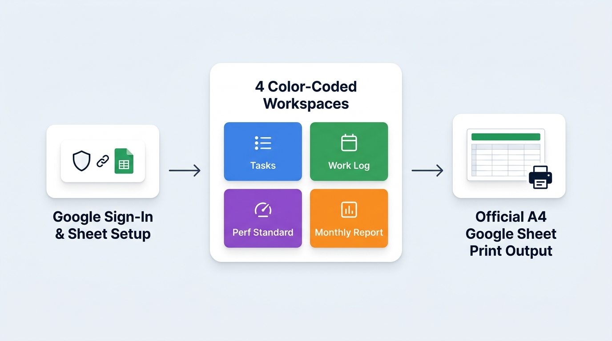

> [!NOTE]
> **How Your Data Stays Safe:** The web app runs directly in your browser and connects straight to your own Google Sheet using your Google Sign-In. Spreadsheet formula columns (IDs, Statuses, Delay Days, Validation Checks, and Evaluation Scores) are protected so nothing in your workbook's formulas is ever broken.

---

## The Complete Workflow at a Glance

Whether you use the app every day or at month-end, your work follows six simple stages:

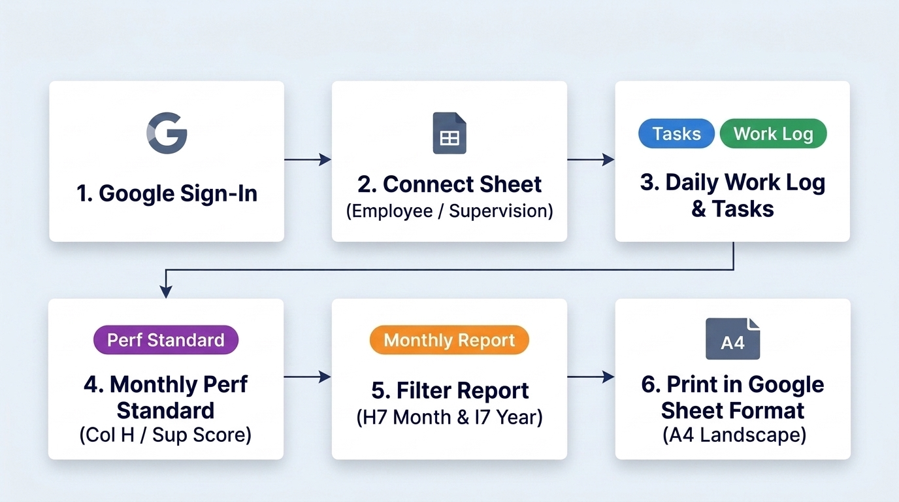

| Stage | Where | How Often | Main Goal |
| :--- | :--- | :--- | :--- |
| **1. Sign In** | Floating Gate | Every browser session / hourly | Unlock access with your Google Account |
| **2. Connect Sheet** | `⚙ Setup` | Once (or when switching sheets) | Link your Employee Monthly Reporting sheet and pick your mode |
| **3. Daily Logging** | **Work Log** (Green) & **Tasks** (Blue) | Daily / weekly | Record time spent and track monthly deliverables |
| **4. Month-End KPI** | **Perf Standard** (Purple) | End of month | Fill in Achievement scores (Col H) or create the next month block |
| **5. Supervisor Review** | `🛡 Supervision Mode` | End of month | Add Supervisor comments, KPI scores (Col K), and remarks (Col L) |
| **6. Final Report** | **Report** (Orange) | End of month | Filter Month/Year (`H7`/`I7`), review, and export/print A4 Landscape PDF |

---

## Step 1: Signing In with Google (Required Every Session)

Whenever you open the Web App in a new browser session—or after your 1-hour Google session expires—a floating window titled **`Sign In Required to Continue`** appears in the center of the screen.

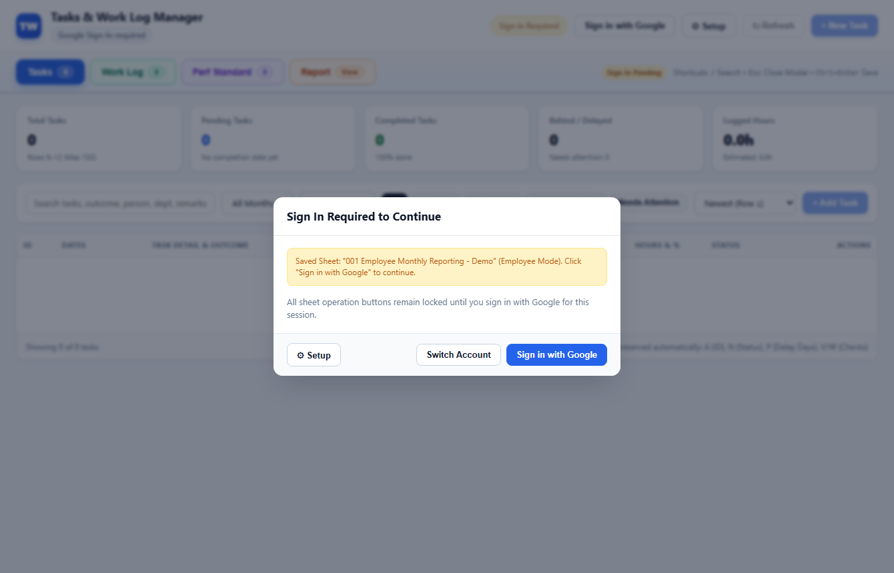

Notice that while this window is open, all buttons behind it (`+ New Task`, `+ Add Task`, `Refresh`, Edit, Delete, etc.) remain blurred and locked so you never accidentally try to save changes without an active Google session.

### What to Do on This Screen

1. **Click `Sign in with Google`** (blue button) and choose the Google Account that has access to your Employee Monthly Reporting Google Sheet.
2. **First-Time Login Permissions (Important):** If this is your **first time signing in**, Google will ask for permissions so the web app can open and update your spreadsheets. **Select/check ALL requested permission checkboxes (or click *Select all*) and allow every permission** before clicking **Continue / Allow**.
3. Need a different Google email? Click **`Switch Account`** instead (this also lets you re-run the permission screen if a checkbox was missed).
4. Need to paste a new spreadsheet link before signing in? Click **`⚙ Setup`**.

> [!IMPORTANT]
> **Grant All Permissions on First Login:** Leaving any requested Google permission unchecked will stop the app from loading your sheet tabs or saving Tasks, Work Logs, KPIs, and Report filters. If that happens, click **`Switch Account`** and grant **all** permissions when signing in again.

**How Long Sign-In Stays Active:** Your spreadsheet link and preferences stay remembered in your browser, so on future visits you simply click **`Sign in with Google`** once (without seeing the permission checkboxes again) and you are right back inside your sheet. For security, Google sign-in sessions stay active for **1 hour** (or until you close the browser tab).

---

## Step 2: Connecting Your Google Sheet (`⚙ Setup`)

On your very first visit (or anytime you want to switch employees/sheets or switch between **Employee Mode** and **Supervision Mode**), the **`Connect Your Google Sheet`** window opens. You can also open it anytime from the **`⚙ Setup`** button in the top-right header.

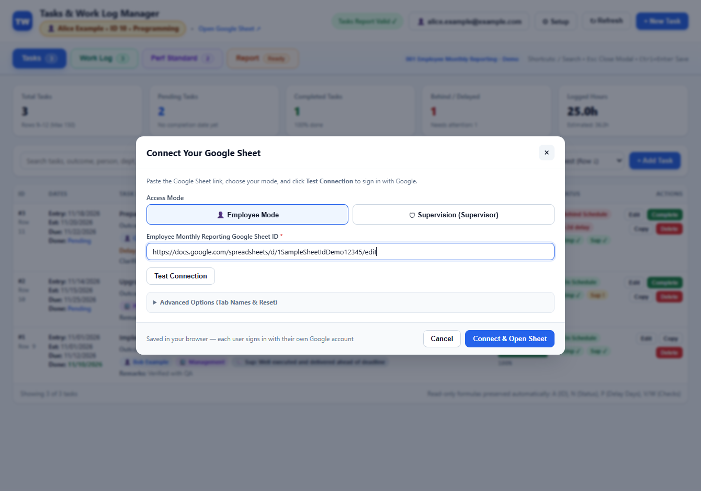

### How to Set Up Your Sheet

1. **Choose Access Mode:**
   - **`Employee Mode`**: Standard view for staff managing their own Tasks, Work Logs, Performance Standard Achievements, and Monthly Report.
   - **`Supervision (Supervisor)`**: Review view for supervisors/managers adding feedback and scores without accidentally changing employee rows.
2. **Paste Your Sheet Link or ID:**
   - Open your Google Sheet in another tab, copy the web address from the address bar (for example, `https://docs.google.com/spreadsheets/d/YOUR_SHEET_ID/edit`), and paste it into **`Employee Monthly Reporting Google Sheet ID *`**.
3. **Test Your Connection:**
   - Click **`Test Connection`**. If you have not signed in yet, Google Sign-In will pop up automatically and then confirm that your sheet tabs are reachable.
4. **Save & Open:**
   - Click **`Connect & Open Sheet`** (blue button) to load your dashboard.

### Helpful Extra Features in Setup

- **Saved Sheets (Quick Switch):** Once you connect more than one sheet (helpful for coordinators or supervisors), previously connected sheets appear under **`Saved Sheets (Quick Switch)`** so you can switch between them with a single click.
- **Advanced Options (Tab Names & Reset):** Expand this section only if your spreadsheet uses custom tab names instead of the standard `Tasks`, `Work log`, `Data`, `Perf Standard`, and `Report`. You can also click **`Copy Team Link`** to copy a pre-configured URL for teammates, or **`Reset Saved Setup`** to clear browser-saved settings.

---

## Step 3: Finding Your Way Around the Dashboard

Once signed in and connected, you will see the main header and four color-coded tabs.

- **Top Identity Bar:** Displays your name, employee ID, and department (`Alice Example • ID 10 • Programming`), plus **`Open Google Sheet ↗`** to open the live spreadsheet in a new tab.
- **Health & Validation Badge:** Shows **`Tasks Report Valid ✓`** in green when all spreadsheet checks pass. If a required field is missing on a task row, it alerts you so you can fix it before submitting your monthly report.
- **Four Color-Coded Workspace Tabs:**
  - **Blue — `Tasks`**: Major monthly tasks and deliverables.
  - **Green — `Work Log`**: Daily activity and time-tracking log.
  - **Purple — `Perf Standard`**: Monthly KPI self-assessment and supervisor scoring.
  - **Orange — `Report`**: Official Monthly Performance Indicator view, month filter, and A4 PDF print.
- **Matching Action Button:** The solid **`+ New ...`** button at the top-right (and **`+ Add ...`** in the filter bar) matches your active tab color.
- **Keyboard Shortcuts:** Press **`/`** to jump to search, **`Esc`** to close a pop-up window, and **`Ctrl+Enter`** to save the open form.

---

## Step 4: Logging Daily Activities in `Work Log` (Green Tab)

Use **`Work Log`** every day to record what you worked on and how many minutes it took.

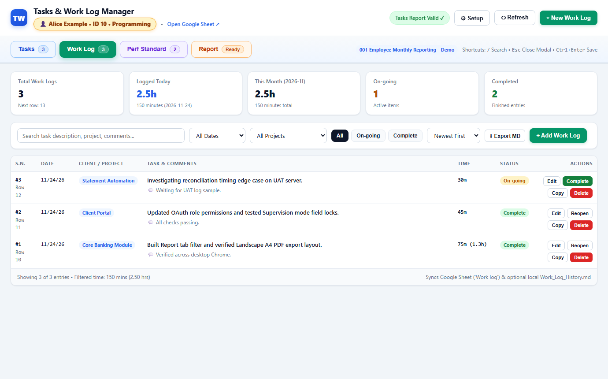

### Understanding the Work Log Screen

- **Summary Cards:** Track **`Total Work Logs`**, **`Logged Today`** (hours and minutes), **`This Month`**, **`On-going`** items, and **`Completed`** items at a glance.
- **Search & Filters:** Search by keyword or filter by **Date**, **Client / Project**, **Status** (`All`, `On-going`, `Complete`), or sort order.
- **`⬇ Export MD`:** Downloads your filtered Work Log entries as a neat Markdown summary file.
- **Row Quick Actions:**
  - **`Edit`**: Update the task description, time, project, or comments.
  - **`Complete`** / **`Reopen`**: Toggle an entry between `On-going` and `Complete` in one click.
  - **`Copy`**: Duplicate an entry as a starting point for similar follow-up work today.
  - **`Delete`**: Remove an accidental entry (asks for confirmation).

### Adding a New Work Log Entry

Click **`+ New Work Log`** (top-right) or **`+ Add Work Log`** (filter bar) to open **`New Work Log Entry`**:

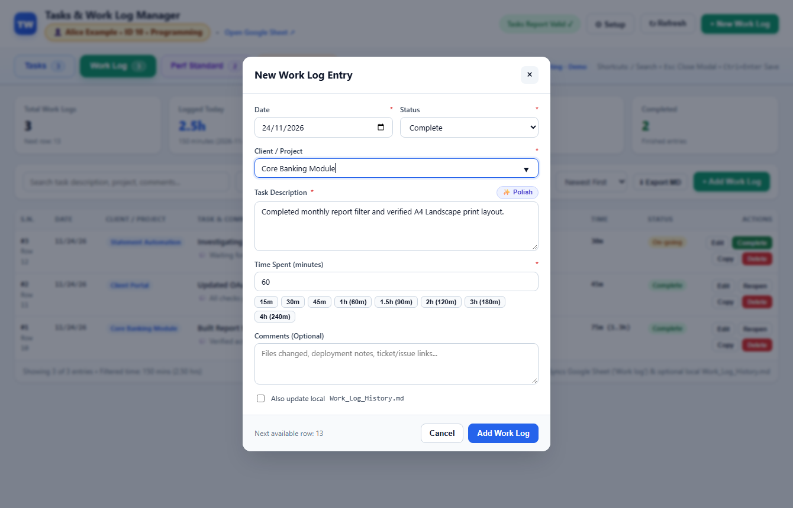

1. **`Date *`**: Defaults to today's date. Change it if you are logging yesterday's work.
2. **`Status *`**: Choose **`Complete`** or **`On-going`**.
3. **`Client / Project *`**: Pick an existing project from the dropdown list or type a new project name.
4. **`Task Description *`**: Write a clear, concise summary of what you worked on (or type quick notes and click **`✨ Polish`** to clean up spelling, grammar, and phrasing, with **`Undo`** available if needed).
5. **`Time Spent (minutes) *`**: Type exact minutes or click one of the quick buttons (`15m`, `30m`, `45m`, `1h (60m)`, `1.5h (90m)`, `2h (120m)`, `3h (180m)`, `4h (240m)`).
6. **`Comments (Optional)`**: Add any extra context, ticket numbers, or handover notes. *(Leave the local history file checkbox unchecked when working purely in the web app.)*
7. Click **`Add Work Log`** (or press `Ctrl+Enter`) to save directly into your Google Sheet.

---

## Step 5: Managing Monthly Deliverables in `Tasks` (Blue Tab)

While **`Work Log`** captures daily effort, **`Tasks`** holds your major deliverables, deadlines, and monthly report items.

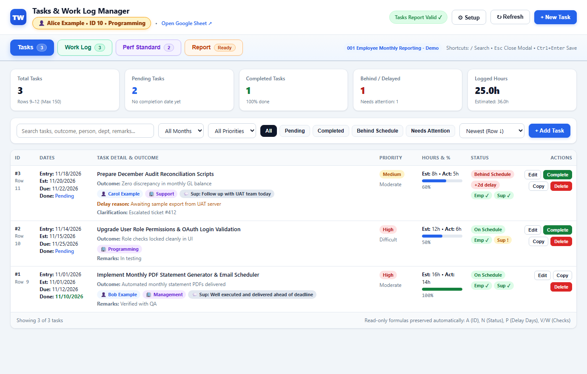

### Reading Status & Check Badges on Each Row

- **Schedule Pill:** **`On Schedule`** (green) or **`Behind Schedule`** with delay days such as **`+2d delay`** (red), calculated automatically by your sheet's formulas.
- **Validation Pills:**
  - **`Emp ✓`** (green) / **`Emp !`** (amber): Employee-side validation from Google Sheet Column `V`.
  - **`Sup ✓`** (green) / **`Sup !`** (amber): Supervisor-side validation from Google Sheet Column `W`.
- **Quick Filters:** Click **`Pending`**, **`Completed`**, **`Behind Schedule`**, or **`Needs Attention`** to focus right away on tasks needing updates before month-end.
- **Row Actions:** Click **`Complete`** on an active task to finish it cleanly, **`Edit`** to adjust details/hours, **`Copy`** to duplicate a recurring monthly task, or **`Delete`** to clear an unused row.

### Creating or Editing a Task

Click **`+ New Task`** or **`+ Add Task`** to open **`New Task Entry`**:

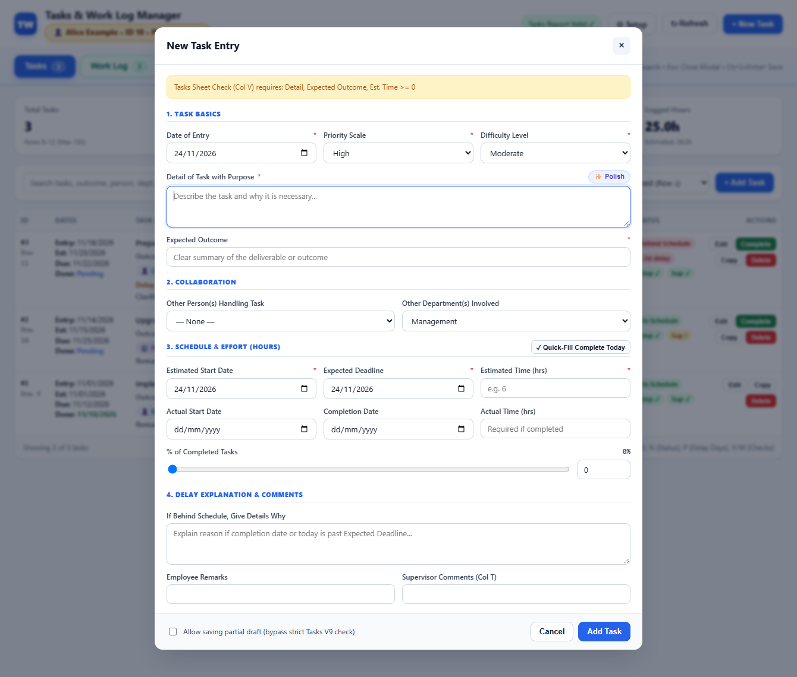

1. **`1. TASK BASICS`**: Enter **`Date of Entry *`**, **`Priority Scale *`** (`High`, `Medium`, `Low`), **`Difficulty Level *`**, **`Detail of Task with Purpose *`** (you can click **`✨ Polish`** to clean up spelling and phrasing, with **`Undo`** if needed), and **`Expected Outcome *`**.
2. **`2. COLLABORATION`**: Select **`Other Person(s) Handling Task`** and **`Other Department(s) Involved`** from your sheet's dropdown lists if others helped.
3. **`3. SCHEDULE & EFFORT (HOURS)`**:
   - Set **`Estimated Start Date *`**, **`Expected Deadline *`**, and **`Estimated Time (hrs) *`**.
   - As work progresses or finishes, fill **`Actual Start Date`**, **`Completion Date`**, **`Actual Time (hrs)`**, and drag the **`% of Completed Tasks`** slider to `100%`.
   - **Shortcut:** Click **`✓ Quick-Fill Complete Today`** to automatically set `Actual Start Date`, `Completion Date`, `Actual Time`, and `100%` in one click.
4. **`4. DELAY EXPLANATION & COMMENTS`**:
   - If today's date or your `Completion Date` is past the **`Expected Deadline`**, fill in **`If Behind Schedule, Give Details Why`** so your validation badge stays green.
   - Add **`Employee Remarks`** or **`Clarification / Comments (Col U)`** if helpful.

> [!IMPORTANT]
> **Formula Columns Are Always Protected:** Notice the notice at the bottom-right of the Tasks table—columns **`A` (ID)**, **`N` (Status)**, **`P` (Delay Days)**, and **`V/W` (Checks)** are read-only and controlled by Google Sheets formulas.

---

## Step 6: Completing Monthly KPIs in `Perf Standard` (Purple Tab)

At the end of each month, open **`Perf Standard`** to record your monthly **`Achievement`** figures for each Key Performance Indicator (KPI).

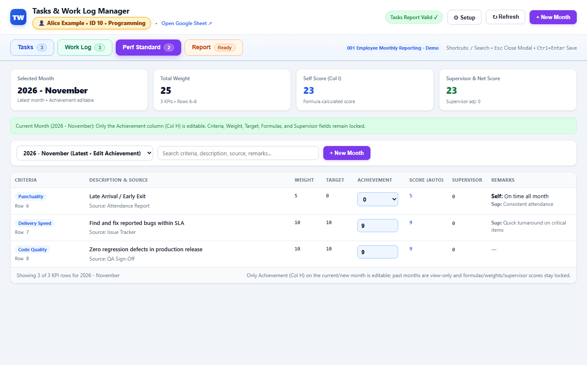

### How Employees Use Perf Standard

- **Month Selector:** Choose which month block to view. Past months open as **view-only** history; your **latest/current month** lets you edit **`Achievement` (Col H)** and **`Self Remarks`**.
- **Dropdowns & Inputs:** Some KPI rows (like Attendance/Punctuality) provide a clean dropdown selector, while others accept numbers. As you save updates, **`Score (Auto)`** and the top KPI cards update from your sheet's formulas.
- **Locked Fields:** **`Criteria`**, **`Description & Source`**, **`Weight`**, **`Target`**, **`Score (Auto)`**, and **`Supervisor`** scores/remarks stay safely locked in Employee Mode.

### Starting a New Month (`+ New Month`)

At the start or end of a new month when your sheet does not yet have a section for that month, click **`+ New Month`** (top-right or beside the search box):

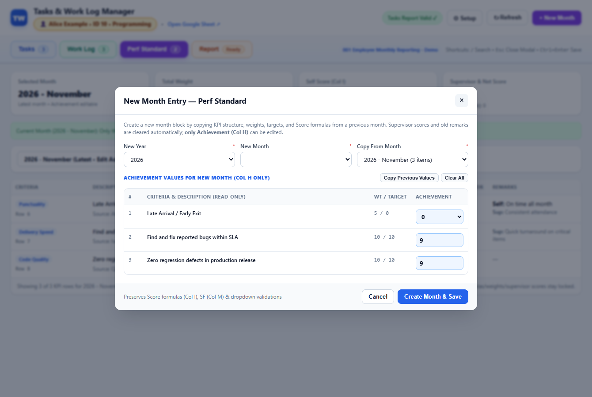

1. Choose **`New Year *`** and **`New Month *`**.
2. Keep **`Copy From Month *`** set to your previous month—the app automatically copies all KPI rows, weights, targets, dropdown validations, and `Score (Col I)` / `SF (Col M)` formulas into a clean new block while clearing old remarks and supervisor scores.
3. Fill in initial **`Achievement (Col H)`** values right inside the table (or use **`Copy Previous Values`** / **`Clear All`**).
4. Click **`Create Month & Save`**.

---

## Step 7: Reviewing & Printing Your Monthly `Report` (Orange Tab)

When all Tasks and Perf Standard entries are ready, switch to the **`Report`** tab to prepare your official Monthly Performance Indicator report.

### 1. Filter by Month & Year (`H7` and `I7`)

At the top of the Report toolbar, use **`MONTH (H7)`** and **`YEAR (I7)`** and click **`Apply`**:
- This updates cells **`H7`** (Month) and **`I7`** (Year) directly inside your live Google Sheet `Report` tab, refreshes all formulas for that month, and reloads the report preview.

### 2. Review in `✨ Web Format`

By default, **`✨ Web Format`** presents your Google Sheet data in an easy-to-read web layout:

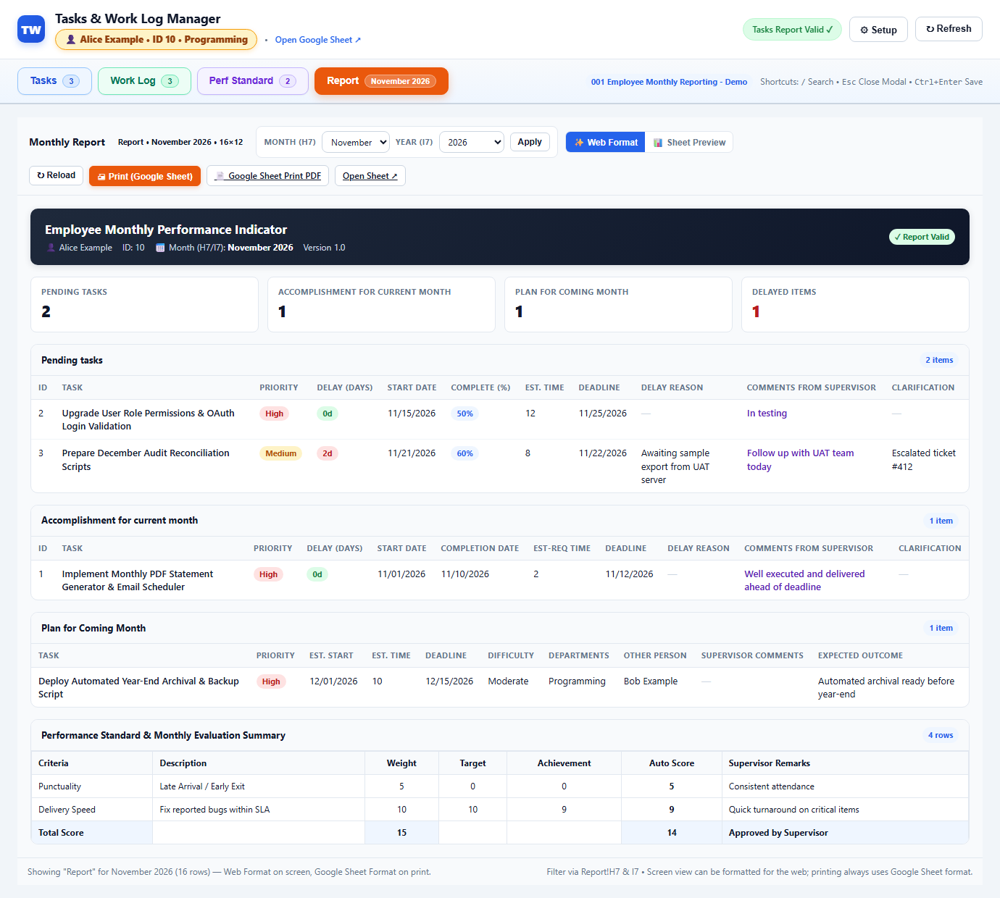

- **Top Summary Cards:** Counts **`Pending Tasks`**, **`Accomplishment for Current Month`**, **`Plan for Coming Month`**, and **`Delayed Items`**.
- **Organized Sections:** Shows **`Pending tasks`**, **`Accomplishment for current month`**, **`Plan for Coming Month`**, and the separated **`Performance Standard & Monthly Evaluation Summary`** table below it.

### 3. Preview Exact Layout in `📊 Sheet Preview`

Click **`📊 Sheet Preview`** whenever you want to inspect the exact row/column grid, merged headers, and borders from your actual Google Sheet before printing:

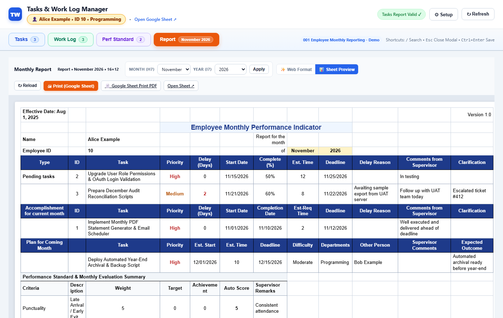

### 4. Printing or Downloading Your Official PDF

Use the action buttons below the filter bar when you are ready to submit or archive your report:

- **`🖨 Print (Google Sheet)`**: Opens the print dialog formatted strictly in **Google Sheet format** (even if you were browsing in `✨ Web Format` on screen!). Set orientation to **Landscape** if your browser does not pre-select it.
- **`📄 Google Sheet Print PDF`**: Downloads an official **A4 Landscape PDF with gridlines** exported directly from Google Sheets.
- **`↻ Reload`** / **`Open Sheet ↗`**: Refreshes latest formula output or opens the `Report` tab directly in Google Sheets.

> [!TIP]
> **Look for `✓ Report Valid`:** Before printing or exporting your PDF, glance at the green **`✓ Report Valid`** pill inside the dark report header (and **`Tasks Report Valid ✓`** in the top bar) to verify zero validation errors remain.

---

## Step 8: Using `Supervision Mode` (For Supervisors & Managers)

Supervisors reviewing team members' workbooks can switch into **`Supervision (Supervisor)`** mode so employee records stay protected while supervisor feedback fields open up cleanly.

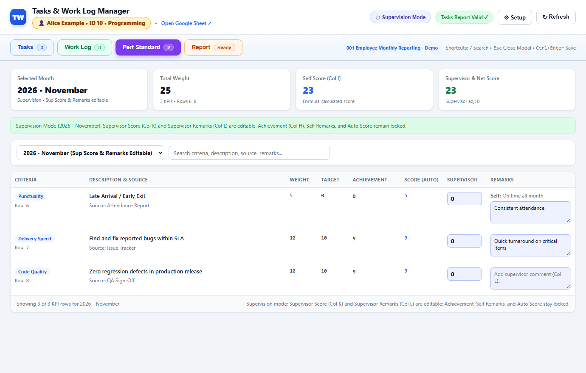

### How to Enable Supervision Mode

1. Click **`⚙ Setup`** in the top-right header.
2. Under **Access Mode**, select **`Supervision (Supervisor)`**.
3. Paste (or pick from **Saved Sheets**) the employee's Google Sheet and click **`Connect & Open Sheet`**.

### What Changes in Supervision Mode

- A purple **`🛡 Supervision Mode`** badge appears in the top header.
- **Create & Delete Safety Lock:** Buttons that add or delete employee rows (`+ New Task`, `+ Add Task`, `+ New Work Log`, `+ New Month`, `Delete`) are hidden automatically.
- **On `Tasks`:** Supervisors can review tasks and enter **`Comments from Supervisor (Col T)`** without altering dates, hours, or employee remarks.
- **On `Perf Standard`:** **`Achievement (Col H)`** and employee self-remarks lock as read-only, while **`Supervisor Score (Col K)`** and **`Supervisor Remarks (Col L)`** become editable input fields.

---

## Quick Troubleshooting & Common Questions

| Situation | What It Means & What to Do |
| :--- | :--- |
| **Buttons look blurred / disabled behind a popup** | Your session needs Google Sign-In (on page load or after 1 hour). Click **`Sign in with Google`** in the floating **`Sign In Required to Continue`** dialog. |
| **Header says `Error in Report` or `Emp !` / `Sup !`** | Click the **`Needs Attention`** filter chip on **`Tasks`**. Common fixes: make sure **`Detail`**, **`Expected Outcome`**, and **`Estimated Time >= 0`** are filled, add **`Actual Start Date`** + **`Delay Reason`** on behind-schedule tasks, and ensure required supervisor review checks (Col `W`) are satisfied. |
| **Setup shows "Permission denied" or cannot load tabs** | Verify the Google Sheet has been shared (Editor access) with the exact Google Account you signed in with, or click **`Switch Account`** and make sure you select and allow **all** requested Google permissions. |
| **`Work Log` or `Tasks` saved in Sheet, not shown in `Report`** | Switch to **`Report`**, verify **`MONTH (H7)`** and **`YEAR (I7)`** match the month you want, and click **`Apply`** (or **`↻ Reload`**). Remember **`Report`** pulls from **`Tasks`** and **`Perf Standard`**, not daily **`Work Log`** rows. |
| **`Google Sheet Print PDF` asks to allow popups or sign-in** | Allow browser pop-ups for `mbnepal.github.io` if prompted so the Google Sheets PDF export download tab can open cleanly. |
